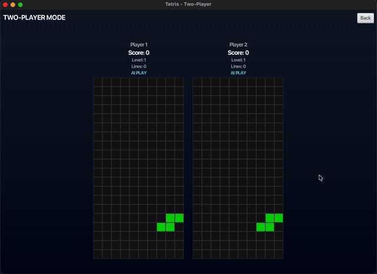
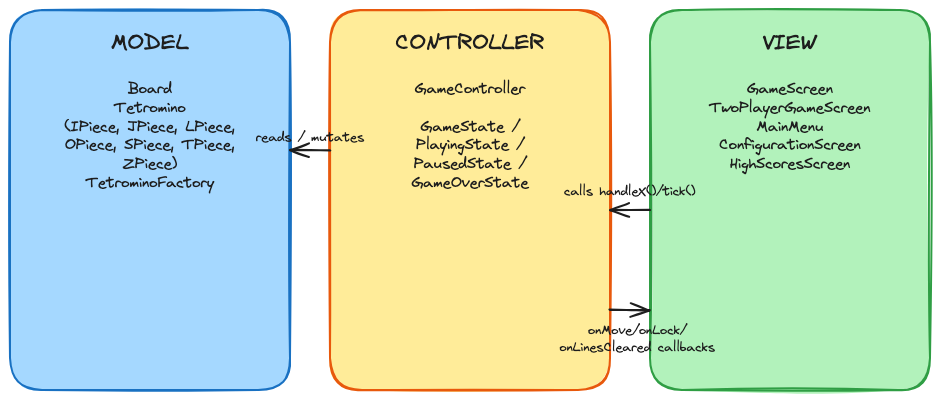
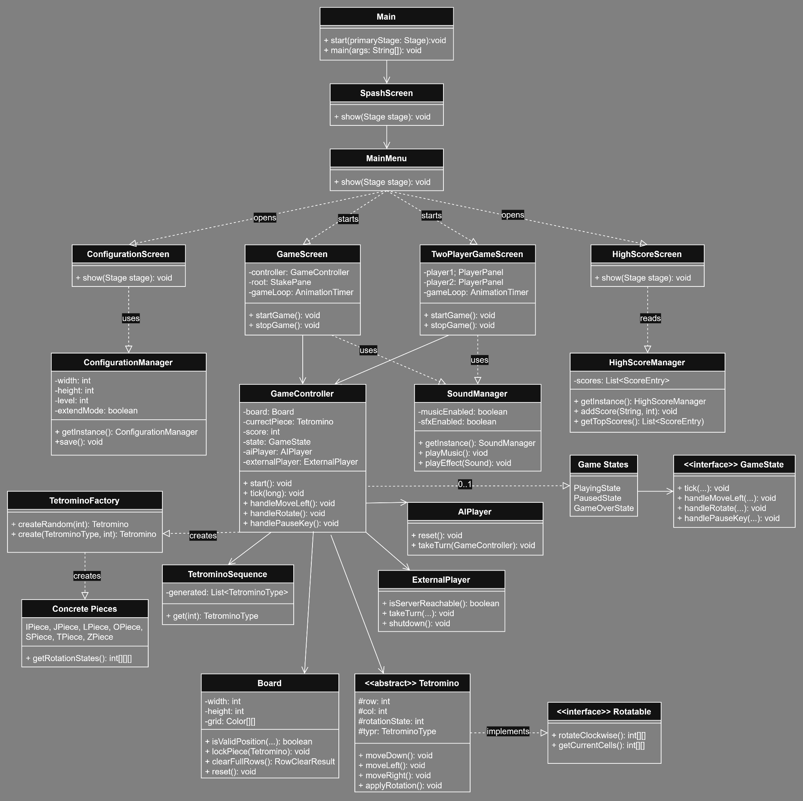
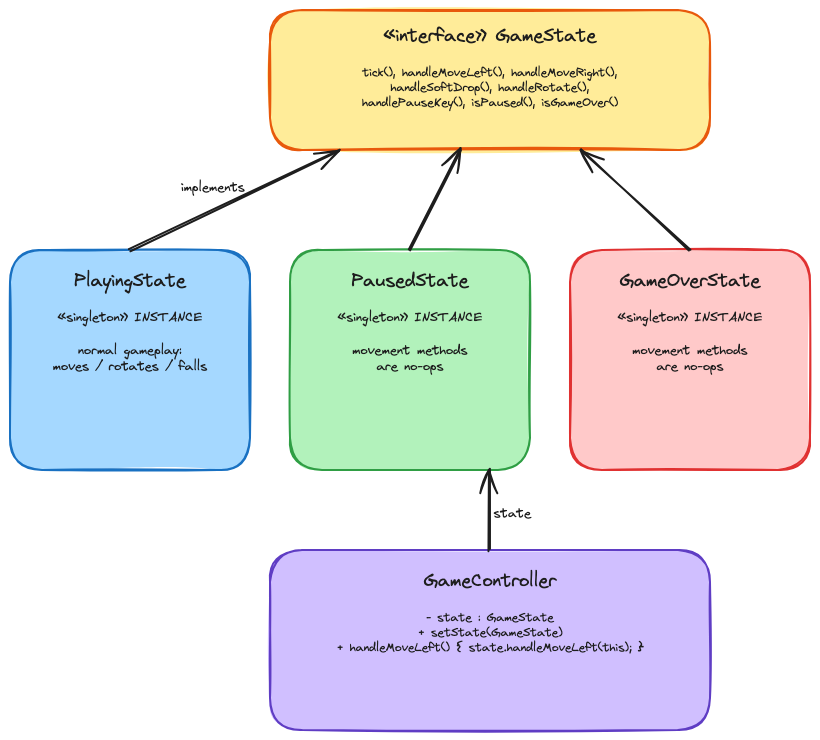

# JavaFX Tetris

[](https://github.com/vy-trg/javafx-tetris/actions/workflows/tests.yml)

A Tetris-style game in **Java 21** and **JavaFX** with an AI player, two-player mode and a networked player. Built by a team of 3; I built the game engine, the AI, two-player mode and the test suite ([details](#team--contributions)).

> Team project for a university Object-Oriented Software Development course (2026), graded **100/100** (Milestone 1) and **96/100** (Final).

<p align="center">
  
  <br>
  <sub>Two-player mode with an AI on each side. Both boards receive the same piece sequence, so identical pieces are expected.</sub>
</p>

📺 **Demo video:** [Watch on YouTube](https://www.youtube.com/watch?v=xKUyLLbiOf4)

---

## Features

- **Classic gameplay** — 7 tetromino types, rotation, soft drop, multi-row clearing, pause/resume
- **Scoring & levels** — 100 / 300 / 600 / 1000 points for 1–4 lines, level progression, live score/level/lines display
- **AI player** — evaluates every possible placement and plays automatically; can be toggled mid-game ([how it works](#how-the-ai-works))
- **External player** — connects to an external game server over TCP (`localhost:3000`), runs network calls off the UI thread, warns when the server is unavailable and resumes control when it comes back
- **Two-player mode** — two boards running simultaneously with an identical piece sequence; each side can be Human, AI or External
- **Dynamic board size** — configurable width (5–15), height (15–30) and starting level (1–10); the window resizes and re-centres automatically
- **Music & sound effects** — background music and effects, toggled in settings or in-game (`M` / `S`)
- **Persistence** — settings and top-10 high scores saved to JSON and restored across runs

## Tech Stack

| Area | Tools |
|---|---|
| Language | Java 21 |
| UI | JavaFX 21 (controls, media, inline CSS styling) |
| Build | Maven |
| Testing | JUnit 5 (incl. parameterized tests), Mockito |
| CI | GitHub Actions (runs the test suite on every push) |
| Version control | Git / GitHub (feature branches, pull requests and code review in the original team repo) |

## Getting Started

**Requirements:** JDK 21+ and Maven 3.9+

```bash
git clone https://github.com/vy-trg/javafx-tetris.git
cd javafx-tetris
mvn clean javafx:run   # run the game
mvn test               # run the test suite
```

> The External Player mode needs a compatible Tetris server listening on `localhost:3000`. The server used during the course is not included in this repository; all other modes work without it.

### Controls (single player)

| Key | Action |
|---|---|
| ← / → | Move left / right |
| ↓ | Soft drop |
| ↑ | Rotate |
| P | Pause / resume |
| M | Toggle music |
| S | Toggle sound effects |
| A | Toggle AI play |

## Architecture

The project follows **Model–View–Controller**. `GameController` contains all game rules and has **no JavaFX UI dependency** — the View calls its command methods (`handleMoveLeft()`, `handleRotate()`, `tick()`…) and the Controller reports events back only through `Runnable` / `IntConsumer` callbacks, so the game engine can be unit-tested without a UI.



<details>
<summary><b>Full class diagram</b></summary>



</details>

## How the AI works

[`AIPlayer`](src/main/java/org/oosd/controller/AIPlayer.java) is a **heuristic search** (not machine learning):

1. When a new piece spawns, it tries **every rotation × every column** on a cloned copy of the board, drops the piece, and clears any full rows.
2. Each resulting board is scored with a weighted sum of four features: **aggregate height**, **lines cleared**, **holes** and **bumpiness** (height difference between neighbouring columns). The four weights are taken from Yiyuan Lee's article [*Tetris AI – The (Near) Perfect Bot*](https://codemyroad.wordpress.com/2013/04/14/tetris-ai-the-near-perfect-player/) (2013), which tuned them with a genetic algorithm.
3. The highest-scoring placement becomes the target. The AI then reaches it **one move at a time** through the same `handleRotate()` / `handleMoveLeft()` / `handleSoftDrop()` calls a human key press uses, so its moves are visible and it obeys exactly the same game rules.

## Design patterns



| Pattern | Where | Why |
|---|---|---|
| **State** | [`GameState`](src/main/java/org/oosd/controller/GameState.java) → `PlayingState`, `PausedState`, `GameOverState` | Removes `if (paused) / else if (gameOver)` branching; each input method in `GameController` is a one-line delegation, and new phases can be added without touching existing code |
| **Factory** | [`TetrominoFactory`](src/main/java/org/oosd/model/TetrominoFactory.java) | Centralises creation of the 7 piece types from a `TetrominoType` enum |
| **Singleton** | `ConfigurationManager`, `HighScoreManager`, `SoundManager`, state objects | One shared source of settings, scores and audio state |
| **Facade** | [`SoundManager`](src/main/java/org/oosd/audio/SoundManager.java) | Hides JavaFX `Media`, `MediaPlayer` and `AudioClip` behind a few simple methods and handles missing audio files gracefully |

### Other Java features used

- **Abstract classes & interfaces** — `Tetromino` (abstract) implements `Rotatable`; 7 concrete piece classes
- **Enums & records** — `TetrominoType` carries each piece's colour; `RowClearResult` record for row-clear results
- **Streams, lambdas & `Comparator`** — sorting and capping the top-10 high scores; event callbacks
- **Generics & thread safety** — [`TetrominoSequence`](src/main/java/org/oosd/controller/TetrominoSequence.java) uses a `synchronized` `List<TetrominoType>` so both players always receive the same pieces
- **Concurrency & networking** — `ExternalPlayer` uses a TCP `Socket` with connect/read timeouts, a single daemon thread `ExecutorService` and `CompletableFuture`, so the game loop never blocks on the network
- **File I/O & JSON** — settings and scores persisted between sessions

## Testing

**21 unit tests, all passing**, run automatically on every push by GitHub Actions. They target the pure-logic classes, so they run in milliseconds without a UI:

- [`BoardTest`](src/test/java/org/oosd/model/BoardTest.java) — default and custom grid sizes, row clearing and scoring, reset
- [`ConfigurationManagerTest`](src/test/java/org/oosd/ConfigurationManagerTest.java) — validated setters (e.g. rejecting out-of-range widths)
- [`HighScoreManagerTest`](src/test/java/org/oosd/HighScoreManagerTest.java) — descending sort, top-10 cap, blank-name handling
- [`AIPlayerTest`](src/test/java/org/oosd/controller/AIPlayerTest.java) — AI finds the well and clears four lines at once; survives 100 pieces on a standard board (uses stub piece sequences for deterministic results)
- [`TetrominoSequenceTest`](src/test/java/org/oosd/controller/TetrominoSequenceTest.java) — two players sharing a sequence get identical pieces; 8 threads reading concurrently all see the same order
- [`GameControllerAdvancedTest`](src/test/java/org/oosd/controller/GameControllerAdvancedTest.java)
  - **Parameterized test** (`@ParameterizedTest` + `@CsvSource`) across 5×15, 10×20 and 15×30 boards
  - **Hand-written stub** recording how many times the game-over callback fires
  - **Mockito mock** verifying the same behaviour

## Project Structure

```
src/
├── main/java/
│   └── org/oosd/
│       ├── view/         Main, SplashScreen, MainMenu, GameScreen,
│       │                 TwoPlayerGameScreen, ConfigurationScreen, HighScoresScreen
│       ├── ConfigurationManager.java, HighScoreManager.java
│       ├── audio/        SoundManager
│       ├── controller/   GameController, GameState + 3 states,
│       │                 AIPlayer, ExternalPlayer, TetrominoSequence
│       └── model/        Board, Tetromino, Rotatable, TetrominoFactory,
│                         TetrominoType, I/J/L/O/S/T/Z pieces
└── test/java/org/oosd/   Board, ConfigurationManager, HighScoreManager,
                          GameController, AIPlayer, TetrominoSequence tests
```

## Credits

| Asset | Author | Licence |
|---|---|---|
| Background music: [*Chiploop*](https://opengameart.org/content/chiploop) | iamoneabe | [CC0 1.0](https://creativecommons.org/publicdomain/zero/1.0/) |
| Sound effects: [*Interface Sounds*](https://kenney.nl/assets/interface-sounds) | Kenney | [CC0 1.0](https://creativecommons.org/publicdomain/zero/1.0/) |
| AI evaluation weights | Yiyuan Lee | See [How the AI works](#how-the-ai-works) |

## Team & Contributions

Built by a team of three.

**Vy Truong** ([@vy-trg](https://github.com/vy-trg))
- **Gameplay engine (Milestone 1):** [`Board`](src/main/java/org/oosd/model/Board.java), the [`Tetromino`](src/main/java/org/oosd/model/Tetromino.java) model (abstract class, `Rotatable` interface, 7 pieces, `TetrominoFactory`) and [`GameScreen`](src/main/java/org/oosd/view/GameScreen.java) rendering, controls, pause and row clearing — delivered through a feature branch and reviewed pull request
- **AI player:** [`AIPlayer`](src/main/java/org/oosd/controller/AIPlayer.java) placement search and evaluation
- **Two-player mode:** [`TwoPlayerGameScreen`](src/main/java/org/oosd/view/TwoPlayerGameScreen.java) and the thread-safe shared piece sequence [`TetrominoSequence`](src/main/java/org/oosd/controller/TetrominoSequence.java)
- **Dynamic board sizing**
- **Design:** MVC structure and the State pattern ([`GameState`](src/main/java/org/oosd/controller/GameState.java) and its implementations)
- **Testing:** all [unit tests](src/test/java/org/oosd), including parameterized tests, a hand-written stub and Mockito mocks

**Aiden Lucas** ([@alucas-gu](https://github.com/alucas-gu)) — team lead and repository manager; game controls; music and sound effects (`SoundManager` facade); external player networking; level/lines display; class diagram and SOLID analysis

**Tasmia Faizal Aboo** ([@tas-mia121](https://github.com/tas-mia121)) — splash, menu, configuration and high-score screens; configuration wiring; high scores and scoring rules; JSON persistence; GRASP analysis

---

*Originally developed in a shared team repository.*

*Unofficial fan project made for learning. Not affiliated with or endorsed by The Tetris Company.*
